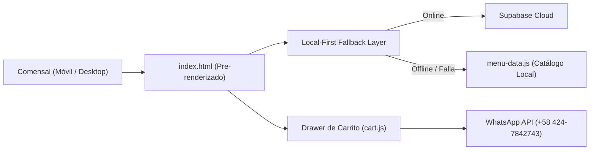

# 🍝 La Finestra — Ristorante e Pastificio Italiano
### Menú Digital Interactivo, Pedidos por WhatsApp y Módulo de Reservas

[](scripts/quality_gate.js)
[](docs/architecture/ARQUITECTURA_TECNICA.md)
[](docs/database/schema.sql)
[](docs/changelog/README.md)

---

## 📖 1. Visión General del Proyecto

**La Finestra** es una plataforma web gastronómica de alta fidelidad desarrollada para el restaurante y pastificio artesanal *La Finestra* (San Cristóbal, Táchira, Venezuela). 

El sistema permite a los comensales explorar la carta de pastas frescas, pizzas artesanales y especialidades italianas, calcular subtotales en tiempo real y enviar pedidos y reservas de mesa directamente al canal oficial de WhatsApp, optimizado para redes móviles con tiempos de carga inferiores a 800ms.



---

## 🏛️ 2. Arquitectura y Principales Capacidades

1. **Local-First Resilient Fallback:** 
   - La carta **nunca falla ni se muestra vacía**. Si el backend o la conexión de red sufren interrupciones, el frontend conmuta automáticamente al catálogo tipado local (`menu-data.js`).
2. **Cero Cascadas de Red (*Zero Micro-Waterfalls*):**
   - Eliminación del antipatrón de carga fragmentada mediante `fetch()`. Todo el HTML crítico está pre-renderizado en el primer ciclo de pintura del navegador (FCP instantáneo, CLS = 0).
3. **Módulo de Pedidos Dinámicos:**
   - Carrito interactivo (`cart.js`) con feedback háptico/visual, cálculo automático de precios en USD a tasa oficial BCV y formateo estructurado para WhatsApp.
4. **Módulo de Reservas de Mesa:**
   - Selección táctil de fecha, turnos de almuerzo/cena y comensales (`reservas.html` + `js/reservas.js`).
5. **Panel Administrativo Desacoplado:**
   - Interfaz de gestión (`admin.html`) modularizada en `css/admin.css` y `js/admin.js`, con autenticación real Supabase Auth (JWT verificado y RLS en servidor).
6. **Esquema de Base de Datos Reproducible:**
   - Scripts DDL (`docs/database/schema.sql`) con Row Level Security (RLS) y DML (`docs/database/seed.sql`) con 58 platos y 5 destacados listos para rehidratar Supabase o PostgreSQL en 1 clic.

---

## 🗂️ 3. Estructura del Repositorio

```text
lafinestra/
├── AGENTS.md                   # Harness institucional y guardrails para asistentes IA
├── GEMINI.md                   # Contexto operativo de alta densidad para agentes
├── SPEC.md                     # Especificación funcional del producto (MVP y Anti-scope)
├── README.md                   # Este documento
├── package.json                # Configuración de comandos npm y quality-gate
├── index.html                  # Landing page y menú digital (pre-renderizado)
├── reservas.html               # Módulo interactivo de reserva de mesas
├── admin.html                  # Panel administrativo desacoplado
├── vercel.json                 # Configuración de rutas y rewrites para Vercel
├── assets/                     # Imágenes y recursos estáticos
├── css/                        # Hojas de estilo modulares por tokens
│   ├── admin.css               # Estilos del panel administrativo
│   ├── base.css                # Reset y tipografía global
│   ├── cards.css               # Tarjetas de platos y destacados
│   ├── cart.css                # Drawer y badge del carrito de pedidos
│   ├── variables.css           # Tokens de diseño (paleta de autor italiana)
│   └── ...
├── js/                         # Lógica desacoplada en ES Modules
│   ├── admin.js                # Lógica del panel administrativo
│   ├── cart.js                 # Estado del carrito y mensajería WhatsApp
│   ├── config.js               # Parámetros públicos de configuración
│   ├── main.js                 # Punto de entrada y orquestador frontend
│   ├── mcard.js                # Renderizado de tarjetas de menú
│   ├── menu-data.js            # Catálogo tipado local (fuente de verdad)
│   ├── menu-fetch.js           # Capa de datos con Local-First Fallback
│   └── reservas.js             # Lógica de reservas de mesa
├── docs/                       # Arquitectura y estándares institucionales
│   ├── INDEX.md                # Índice central de navegación documental
│   ├── architecture/           # Blueprints arquitectónicos y flujos
│   ├── database/               # schema.sql (DDL + RLS) y seed.sql (DML)
│   ├── standards_and_harness/  # Calidad, checklist y catálogo 5-Whys
│   └── changelog/              # Bitácoras modulares por dominio
└── scripts/                    # Herramientas de automatización
    └── quality_gate.js         # Compuerta de calidad automatizada
```

---

## ⚡ 4. Inicio Rápido y Desarrollo Local

### Prerrequisitos
- Node.js >= 18 (opcional para correr la compuerta de calidad localmente).
- Navegador web moderno con soporte para ES Modules.

### Ejecución Local
Para levantar un servidor de desarrollo estático:

```bash
# Opción 1: Servidor Node ligero
npx serve .

# Opción 2: Python HTTP Server
python -m http.server 8000
```

Abre en tu navegador `http://localhost:3000` o `http://localhost:8000`.

---

## 🛡️ 5. Compuerta de Calidad (Quality Gate)

Antes de realizar cualquier commit o despliegue a producción, es mandatorio ejecutar la compuerta de calidad automatizada:

```bash
npm run quality-gate
```

La compuerta valida mecánicamente:
1. **Zero-Trust Security:** Cero contraseñas maestras o claves de servicio expuestas.
2. **Local-First Fallback:** Disponibilidad inmediata del catálogo ante caída de red.
3. **Database Integrity:** Consistencia entre `schema.sql` y `seed.sql`.
4. **Governance:** Presencia del arnés institucional (`AGENTS.md`, `SPEC.md`, `docs/`).
5. **Link Integrity:** Cero rutas rotas hacia archivos CSS y módulos JS.
6. **Anti-Bloat:** Cero código muerto, scripts zombies o fragmentos huérfanos.

---

## 🗄️ 6. Restauración de Base de Datos (Supabase / PostgreSQL)

Si deseas conectar una nueva base de datos de Supabase:
1. Crea un proyecto en [Supabase](https://supabase.com).
2. Ve al **SQL Editor** y ejecuta [`docs/database/schema.sql`](docs/database/schema.sql) para crear las tablas, índices y políticas RLS.
3. Ejecuta [`docs/database/seed.sql`](docs/database/seed.sql) para insertar los 58 platos y 5 destacados.
4. Actualiza las variables `SUPABASE_URL` y `SUPABASE_ANON` en [`js/config.js`](js/config.js).

---

## 📜 7. Licencia y Créditos
- **Desarrollado para:** La Finestra (San Cristóbal, Venezuela).
- **Estándar de Ingeniería:** Framework Institucional Harness 2026.
