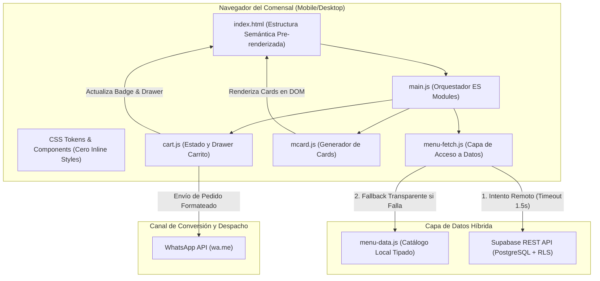
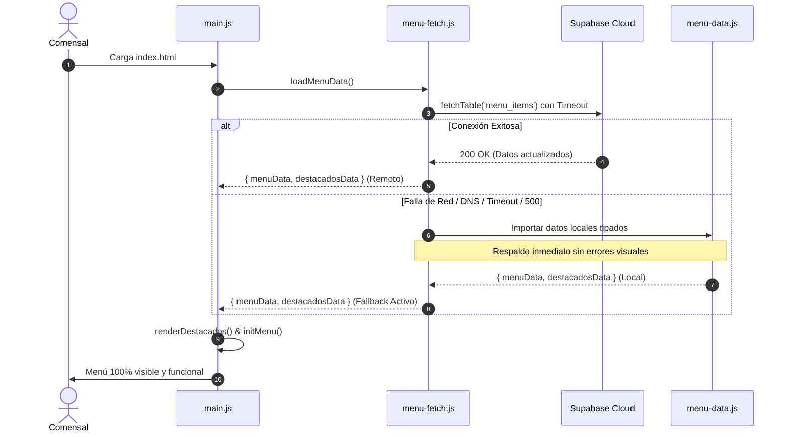

# 🏛️ Arquitectura Técnica y Desacoplamiento — La Finestra

> **Documento de Especificación Arquitectónica (Target State)**  
> **Versión:** 2.0.0 · **Enfoque:** Vanilla Modular, Local-First Resiliente, Mobile-First

---

## 1. Visión General del Sistema

La Finestra opera como una aplicación web de alto rendimiento optimizada para conversión gastronómica. No utiliza frameworks reactivos pesados (React, Vue) para garantizar tiempos de carga inferiores a 800ms en redes móviles venezolanas (3G/4G).

---

## 2. Patrón Local-First Resilient Fallback

Para evitar el fallo catastrófico observado en el diagnóstico (donde la caída de Supabase vació el menú por completo), se diseñó el patrón **Local-First Resilient Fallback**:

### Invariantes del Fallback:
1. `loadMenuData()` **nunca lanza una excepción no controlada** que interrumpa la ejecución de `main.js`.
2. Si Supabase responde, la capa devuelve los datos más frescos del servidor.
3. Si Supabase falla por cualquier causa (DNS, corte de energía, límite de cuota o latencia > 1500ms), se sirve el catálogo local de inmediato con una advertencia en la consola de depuración.

---

## 3. Estado y Ciclo de Vida del Carrito (`cart.js`)

El módulo `cart.js` implementa un patrón Singleton encapsulado con las siguientes responsabilidades:

1. **Estado en Memoria:** Arreglo `items` con `{ id, name, price, qty }`.
2. **Cálculos Aritméticos Seguros:**
   - Subtotal calculado en punto flotante y formateado a dos decimales con coma decimal (`$X,XX`).
   - Sincronización automática de unidades totales en el badge flotante.
3. **Persistencia Ligera:** Sincronización opcional con `sessionStorage` para no perder el pedido al recargar la página.
4. **Generador de Mensajes WhatsApp:** Formatea una lista con viñetas, total en USD, nota de tasa BCV y saludo inicial listo para enviar.

---

## 4. Desacoplamiento de la Interfaz (Zero Micro-Waterfalls)

En el estado anterior, `index.html` realizaba 7 peticiones `fetch()` asíncronas para descargar trozos de HTML (`navbar.html`, `hero.html`, `menu.html`, etc.).

### Problemas Resueltos:
* **Eliminación del parpadeo (CLS):** La estructura base reside directamente en el documento HTML principal, permitiendo que el navegador dibuje la interfaz en el primer ciclo de renderizado.
* **Compatibilidad Offline / Local:** Permite probar y previsualizar el sitio abriendo `index.html` directamente o sirviéndolo desde cualquier CDN estático sin configuraciones complejas de CORS.
* **Mejora del SEO y Redes Sociales:** Los metadatos OpenGraph y el contenido semántico son inmediatamente visibles para los motores de búsqueda y la vista previa de enlaces en WhatsApp/Telegram.
