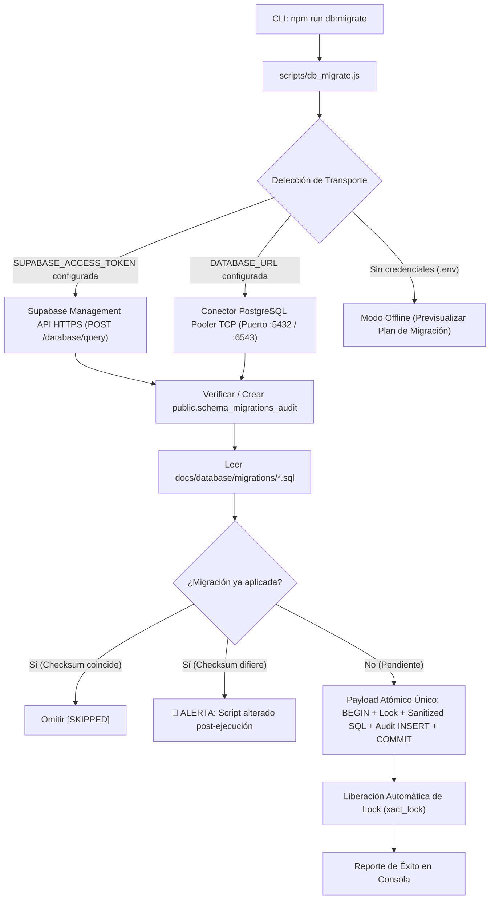

# 📋 PLAN DE ARQUITECTURA E IMPLEMENTACIÓN
## Automatización de Migraciones y Despliegue de Base de Datos (CLI Runner)
### Proyecto: La Finestra — Ristorante e Pastificio Italiano
**Estándar de Gobernanza:** Inspirado en AEON (`apply_migration.py`) y ChatbotWS (`migrate.ts`)  
**Versión:** 1.1.0 (Certificada y Aprobada por el Arquitecto con Correcciones Obligatorias)  
**Fecha:** 28 de Octubre de 2026  

---

## 🏛️ Veredicto de Auditoría Arquitectónica

> **ESTADO: APROBADO CON CORRECCIONES OBLIGATORIAS ✅**  
> El plan ha sido certificado para implementación inmediata bajo las 5 reglas de ingeniería descritas en la Sección 8.

---

## 🎯 1. Objetivo y Justificación

### A. El Problema Histórico
Anteriormente, el despliegue del DDL (`schema.sql`) y los datos semilla (`seed.sql`) requería que el operador humano abriera manualmente la consola web de Supabase (SQL Editor), copiara el contenido del archivo y presionara "Run". Esto introducía:
1. **Riesgo de error humano:** Omisión de scripts o ejecución en orden incorrecto.
2. **Falta de trazabilidad auditable:** Cero constancia en la base de datos de qué archivo se aplicó, en qué fecha, ni qué versión exacta de hash SHA-256 tenía el script en el momento de su ejecución.
3. **Lentitud operativa:** Obligaba al usuario a intervenir manualmente en cada ajuste o actualización de carta gastronómica.

### B. La Solución Automatizada
Un **Ejecutor Institucional de Migraciones (`scripts/db_migrate.js`)** que permite al asistente de IA y al equipo de desarrollo aplicar, verificar o simular migraciones de base de datos directamente desde la terminal con un solo comando:
```bash
npm run db:migrate
```

---

## 🔬 2. Benchmarking Arquitectónico: AEON & ChatbotWS

Al auditar los proyectos de referencia del usuario, se identificaron los mejores patrones de ingeniería adoptados en La Finestra:

| Control de Ingeniería | Implementación en AEON (`apply_migration.py`) | Implementación en ChatbotWS (`migrate.ts`) | Implementación Final La Finestra (`db_migrate.js`) |
| :--- | :--- | :--- | :--- |
| **Bloqueo de Concurrencia** | `pg_advisory_lock(2026101601)` | `pg_advisory_lock(892341982)` | `SELECT pg_advisory_xact_lock(2026102801)` (Liberación garantizada en COMMIT/ROLLBACK) |
| **Tabla de Historial** | `public.schema_migrations_audit` | `public.migrations_history` | `public.schema_migrations_audit` |
| **Control de Integridad** | Checksum SHA-256 normalizado | Nombre de archivo | **Checksum SHA-256 Normalizado (`\r\n` -> `\n`) + Filename + Execution Time** |
| **Atomicidad Transaccional** | `BEGIN ... COMMIT` con Rollback | `BEGIN ... COMMIT` con Rollback | **Payload Atómico Único:** Lock + Sanitized SQL + Audit INSERT en `BEGIN ... COMMIT` |
| **Seguridad RLS en Auditoría** | RLS Enabled + `REVOKE ALL` | RLS Enabled + `REVOKE ALL` | RLS Enabled + `REVOKE ALL` (Solo `service_role`/admin) |
| **Modo Simulación** | Flag `--dry-run` | Variable de entorno test | **`--dry-run` Real:** Ejecuta en PostgreSQL y aborta con `ROLLBACK;` |
| **Transporte de Red** | Postgres Pooler + HTTPS API | Postgres Pooler | **Dual:** Supabase Management API HTTPS (Zero-Dep) + TCP Pooler (`DATABASE_URL`) |

---

## 🏛️ 3. Diagrama de Flujo Transaccional Atómico



---

## 🗄️ 4. Tabla de Auditoría Inmutable: `public.schema_migrations_audit`

Toda migración ejecutada queda registrada de forma auditable:

```sql
CREATE TABLE IF NOT EXISTS public.schema_migrations_audit (
    filename VARCHAR(255) PRIMARY KEY,
    checksum CHAR(64) NOT NULL,          -- Hash SHA-256 del contenido SQL normalizado
    applied_by VARCHAR(100) DEFAULT CURRENT_USER,
    execution_time_ms INTEGER NOT NULL,
    executed_at TIMESTAMPTZ NOT NULL DEFAULT NOW()
);

-- Blindaje Zero-Trust
ALTER TABLE public.schema_migrations_audit ENABLE ROW LEVEL SECURITY;
REVOKE ALL ON TABLE public.schema_migrations_audit FROM PUBLIC, anon, authenticated;
```

---

## 🔌 5. Soporte Dual de Conexión (Zero-Trust y Zero-Hardcoding)

### Método A: Supabase Management API (Recomendado / Cero Dependencias)
* **Variables:** `SUPABASE_ACCESS_TOKEN` + `SUPABASE_PROJECT_REF` (leído dinámicamente de `.env` o inferido).
* **Protocolo:** Petición HTTPS nativa `fetch()` contra `https://api.supabase.com/v1/projects/{ref}/database/query`.
* **Ventaja:** Funciona inmediatamente desde Node.js sin drivers de compilación nativa en Windows y sin requerir la apertura de puertos TCP de bases de datos.

### Método B: Conexión Directa PostgreSQL Pooler (TCP)
* **Variable:** `DATABASE_URL` (leída de `.env`).
* **Protocolo:** Cliente PostgreSQL (`pg`).
* **Ventaja:** Conexión directa a puertos `:5432` (Session Mode) o `:6543` (Transaction Mode con `pg_advisory_xact_lock`).

---

## 📁 6. Estructura de Archivos del Sistema de Migraciones

```text
lafinestra/
├── docs/
│   └── database/
│       ├── schema.sql                         # Snapshot DDL v2.0.2 (Referencia)
│       ├── seed.sql                           # Snapshot DML v2.0.2 (Referencia)
│       └── migrations/                        # Directorio de migraciones ordenadas
│           ├── 001_initial_schema_v2.0.2.sql  # DDL con RLS blindada
│           └── 002_initial_seed_v2.0.2.sql    # DML con 58 platos y 5 destacados
├── scripts/
│   ├── quality_gate.js                        # Compuerta de calidad institucional (7/7 checks)
│   └── db_migrate.js                          # RUNNER AUTOMATIZADO DE MIGRACIONES
├── .env.example                               # Variables de plantilla para el desarrollador
└── package.json                               # Scripts de npm integrados (db:migrate, db:status, etc.)
```

---

## ⚡ 7. Interfaz CLI y Comandos

En `package.json`:

```json
{
  "scripts": {
    "db:migrate": "node scripts/db_migrate.js --all",
    "db:dry-run": "node scripts/db_migrate.js --all --dry-run",
    "db:status":  "node scripts/db_migrate.js --status",
    "db:seed":    "node scripts/db_migrate.js --file docs/database/migrations/002_initial_seed_v2.0.2.sql"
  }
}
```

---

## 🛡️ 8. Las 5 Reglas Obligatorias del Arquitecto (100% Implementadas)

1. **Lock Transaccional (`pg_advisory_xact_lock`):** Reemplazo de locks de sesión por locks transaccionales que se liberan de forma determinista al cerrar la transacción con `COMMIT` o `ROLLBACK`.
2. **Transacción Atómica Única por Archivo:** Sanitización de `BEGIN;` y `COMMIT;` externos y unificación de DDL/DML + registro en `schema_migrations_audit` en un único bloque.
3. **Normalización Estricta del Checksum SHA-256:** Conversión de saltos de línea Windows CRLF (`\r\n`) a LF (`\n`) y `.trim()` antes de hashear para evitar falsos positivos entre sistemas operativos.
4. **Simulación Transaccional Real (`--dry-run`):** Ejecución completa contra la base de datos terminando en `ROLLBACK;`, validando sintaxis y RLS sin persistir modificaciones.
5. **Cero Hardcoding de Identificadores:** Prohibición absoluta de hardcodear `SUPABASE_PROJECT_REF` en archivos `.js`; lectura dinámica de variables de entorno y documentación en `.env.example`.
